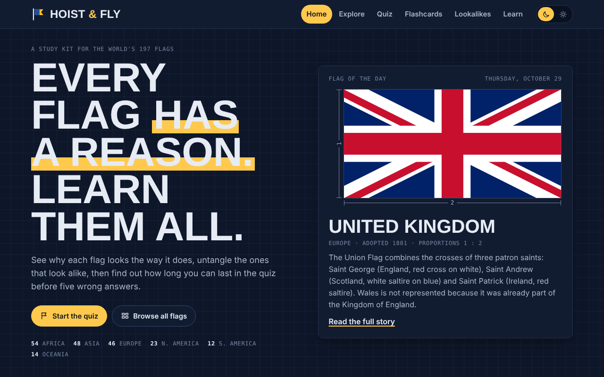
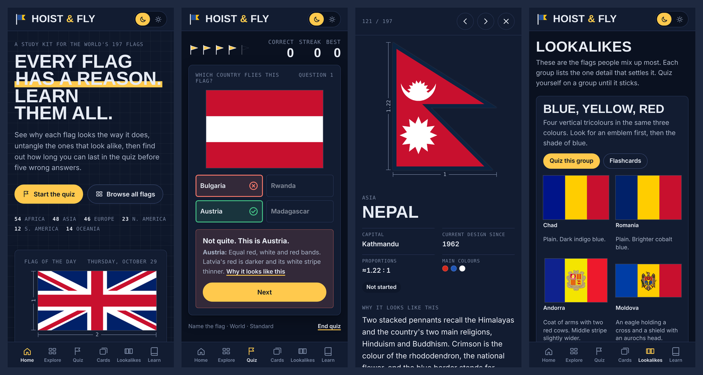
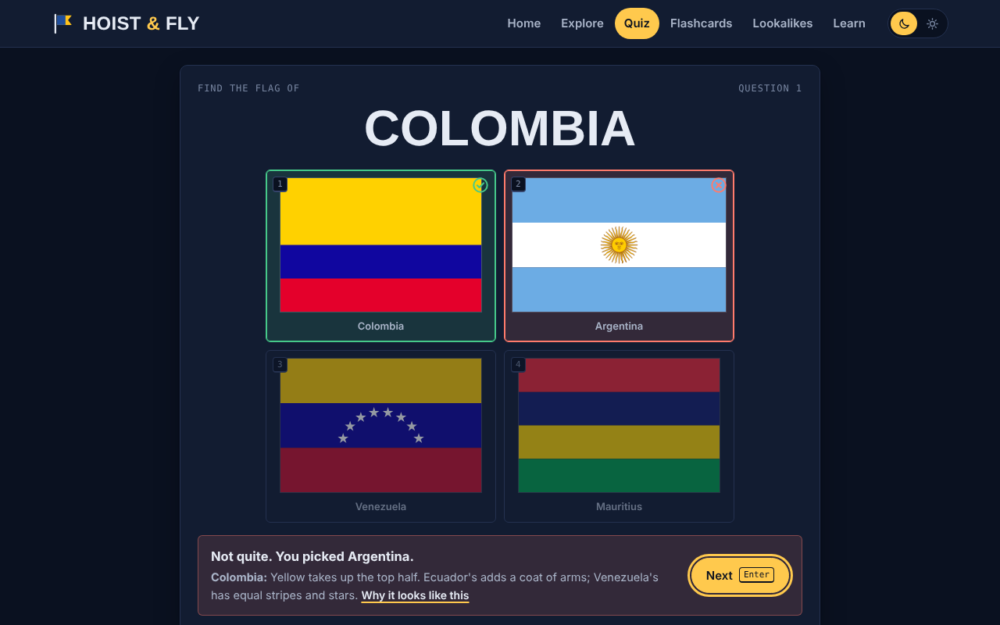
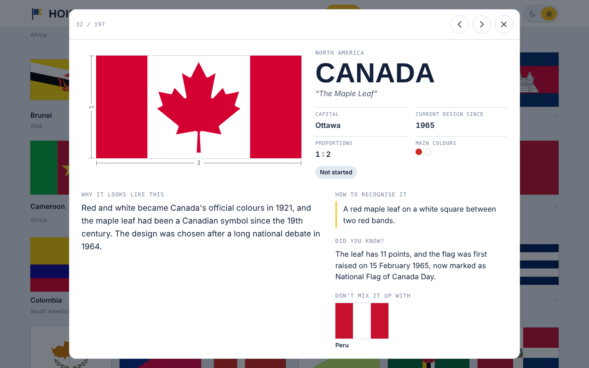

# Hoist & Fly

A study site for the flags of all 197 countries. Every flag comes with the story of why it looks the way it does, and you can drill them with a quiz, flashcards and a guide to the flags people mix up most.

It is a single static page with no server, no framework and no build step needed to run it: open `site/index.html` or upload the `site/` folder to any web host.



## What's in it

| Section | What it does |
|---|---|
| **Home** | A flag of the day, your progress by continent, the flags you keep missing, and a fun fact. |
| **Explore** | All 197 flags. Search by country, capital or nickname; filter by region, colour, layout (stripes, cross, triangle…) or symbol (star, crescent, sun, animal, writing…); sort A–Z, by region, by age or by how well you know them. |
| **Flag details** | Each flag drawn to its official proportions with dimension lines, plus capital, year adopted, main colours, *why it looks like this*, *how to recognise it*, a fun fact and its lookalikes. Afghanistan, Syria and Kyrgyzstan also show their previous or alternative flags. |
| **Quiz** | Multiple choice that ends on your fifth wrong answer. Modes: *Name the flag*, *Find the flag* or *Mixed*; any continent or the whole world; *Standard* or *Tricky* wrong answers (lookalikes). Shows a tip after every answer and the flags that got you at the end. |
| **Flashcards** | Flag → country or country → flag. "Still learning" cards come back a few cards later. Decks by region, not-yet-mastered, needs-review or a custom set. |
| **Lookalikes** | 23 groups of easily confused flags (Chad/Romania, Indonesia/Monaco, Ireland/Côte d'Ivoire…) with the one detail that tells each apart, and buttons to quiz or drill each group. |
| **Learn** | Parts of a flag, proportions at a glance, a glossary, ten flag families (Nordic cross, pan-African, pan-Arab…) and 18 records and oddities. |

Also: dark mode by default with a light/dark switch, progress tracking (three correct answers in a row = mastered), keyboard shortcuts, and a layout that works on phones (bottom tab bar, full-screen flag details, answers sized for thumbs).

<p align="center"></p>

<p align="center">
  
  
</p>

## Quick start

View it locally:

```sh
npm run serve          # or: python3 -m http.server 8000 --directory site
# then open http://localhost:8000
```

Publish it: drag the `site/` folder onto [netlify.com/drop](https://netlify.com/drop), or connect this repository to Netlify (the included `netlify.toml` already points at `site/`). See [docs/DEPLOYMENT.md](docs/DEPLOYMENT.md) for Netlify, Cloudflare Pages, GitHub Pages and custom domains.

## Editing

| I want to… | Do this |
|---|---|
| Fix or rewrite a flag's story | Edit its entry in `content/<region>.js`, then `npm run build`. See [docs/CONTENT.md](docs/CONTENT.md). |
| Change a lookalike group, family, record or glossary term | Edit `content/extras.js`, then `npm run build`. |
| Change the design or behaviour | Edit `src/style.css`, `src/body.html` or `src/app.js`, then `npm run build`. See [docs/ARCHITECTURE.md](docs/ARCHITECTURE.md). |
| Update a flag image (a country changed its flag) | Follow [docs/FLAG-ARTWORK.md](docs/FLAG-ARTWORK.md#when-a-country-changes-its-flag). |
| Check nothing broke | `npm test` (needs Playwright, see below). |

`npm run build` validates all 197 entries (missing fields, unknown colours or tags, broken lookalike links, wrong count) and stops with a message if anything is off, then regenerates `site/index.html`.

## Commands

| Command | What it does | Needs |
|---|---|---|
| `npm run build` | Validate content and rebuild `site/index.html` | Node.js 18+ |
| `npm run serve` | Serve `site/` at http://localhost:8000 | Python 3 |
| `npm test` | Headless browser checks of every view on desktop and phone sizes | Python 3, `pip install playwright`, then `playwright install chromium` |
| `npm run flags` | Re-render all flag images from scratch (about 1–2 minutes) | TeX Live with the `worldflags` package, poppler-utils (`pdftocairo`), Python 3 with Pillow and Playwright |
| `npm run sheets` | Contact sheets of every flag image in `build/sheets/` for visual checking | Python 3 with Playwright |
| `npm run build:artifact` | Build the variant published as a Claude artifact (`build/artifact/index.html`) | Node.js |

There are no npm dependencies; `npm` is only used as a script runner, and each script can be run directly with `node` or `python3`.

## Project layout

```
site/                 The deployable website (generated, committed so it can be uploaded as is)
  index.html          One self-contained page: markup, styles, script and all flag data inline
  flags/              200 flag images (SVG, or WebP for the 17 with heavy coats of arms)
src/                  Page source
  body.html           Markup for every view, the icon sprite and the detail dialog
  style.css           Design tokens (dark default, light override) and all styles
  app.js              Router, explore grid, detail sheet, quiz, flashcards, progress store, theme switch
content/              The words: one entry per country plus lookalikes, families, records, glossary
  africa.js  asia.js  europe.js  americas_oceania.js  extras.js
data/
  flagmeta.json       File name and intrinsic size of each image (written by the flag pipeline)
  ratios.tsv          Official proportions read from each drawing (written by the flag pipeline)
  data.json           Merged content (generated, not committed)
tools/                Build and test scripts (Node.js and Python)
flags-pipeline/       Renders the flag images from the worldflags LaTeX package
docs/                 Documentation and screenshots
netlify.toml          Tells Netlify to publish site/ with no build step
```

## Documentation

- [docs/ARCHITECTURE.md](docs/ARCHITECTURE.md): how the page works (views, routing, quiz and flashcard logic, progress storage, theming, responsive layout, accessibility).
- [docs/CONTENT.md](docs/CONTENT.md): the content format, writing style, and the editorial decisions behind particular flags.
- [docs/FLAG-ARTWORK.md](docs/FLAG-ARTWORK.md): how the 200 flag images are produced, and how to update one.
- [docs/DEPLOYMENT.md](docs/DEPLOYMENT.md): hosting on Netlify, Cloudflare Pages or GitHub Pages, and using your own domain.
- [docs/CHANGELOG.md](docs/CHANGELOG.md): version history.

## Credits

- Flag drawings are rendered from [worldflags](https://ctan.org/pkg/worldflags), a LaTeX/TikZ package by Wilhelm Haager distributed under the LaTeX Project Public License 1.3. Afghanistan (2021), Kyrgyzstan (2023) and Syria (2025) were redrawn for their current flags; see [docs/FLAG-ARTWORK.md](docs/FLAG-ARTWORK.md).
- Fonts: [Big Shoulders Display](https://fonts.google.com/specimen/Big+Shoulders+Display), [Public Sans](https://fonts.google.com/specimen/Public+Sans) and [IBM Plex Mono](https://fonts.google.com/specimen/IBM+Plex+Mono), loaded from Google Fonts.
- Flag stories, tips and facts were written for this project. Sources consulted for recent changes are listed in [docs/CONTENT.md](docs/CONTENT.md#sources).

## License

No license has been chosen yet, so by default all rights are reserved. If you want others to reuse the project, add a `LICENSE` file (for example MIT for the code and CC BY 4.0 for the written content). The worldflags drawings keep their own license (LPPL 1.3).
